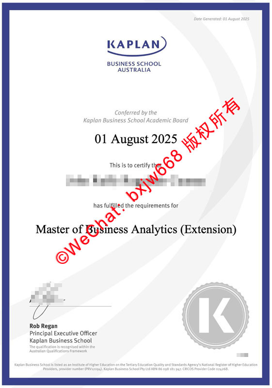

<!--
title: 澳大利亚卡普兰商学院毕业证（KBS diploma）视觉构架与官方防伪特征核验指南
description: 本文立足于澳大利亚卡普兰商学院（Kaplan Business School）官方颁发的学位证书真实样本，从皇家蓝精细边框、KAPLAN品牌徽标、商科专业文本层级及灰色齿轮状K字防伪徽章等多个维度进行全面拆解与参照比对，为您提供专业、实用的海外学历证书核验指南。
keywords: 卡普兰商学院毕业证, KBS diploma, 卡普兰商学院学位证样本, 澳洲商学院证书比对, 海外学历认证核验, Kaplan Business School毕业证排版
-->
# 澳大利亚卡普兰商学院学位证书（Kaplan Business School diploma）视觉构架与官方防伪特征核验

在当今全球化商业人才的招募与选拔中，对海外高等教育背景的真实性评估已成为人力资源部门与合规核查机构的日常核心工作。澳大利亚卡普兰商学院（Kaplan Business School，简称 KBS）作为在全球高等教育及职业培训领域享有盛誉的学术机构，其颁发的硕士及学士学位证书在国际商业市场中具有极高的认可度。

为了满足企事业单位在人才引进时的学历背景核查需求，本文将以卡普兰商学院官方标准的商科硕士学位证书真实样本为参照，从证书的整体版面设计、核心视觉标识、文本层级逻辑以及底部防伪防假标识等维度进行多维度的独家拆解。

## 卡普兰商学院证书的整体设计美学

有别于澳洲传统公立大学偏爱的古典厚重风格，卡普兰商学院的学位证书在视觉上明显带有现代商业社会的干练、精致与数字化美学特征。整个证书采用纵向标准A4版面，选用高白度、高平整度的特种涂布证券纸张印刷，触感细腻且具有一定的挺度。

在色彩搭配上，证书以卡普兰集团标志性的**皇家蓝（Royal Blue）**作为主基调。整个版面的最外层包裹着一道精细的蓝色矩形边框，同时背景中融入了淡蓝色的半透明流线型暗纹，这种冷色调的组合既彰显了商学院的严谨与理性，又通过复杂的背景底纹提升了文件的防伪门槛。

## 顶部官方徽标与学术委员会宣告词核对

证书的上半部分是学校合法身份的集中展现区，包含学校的核心品牌标识以及授予机构的法理宣告。

### 1. 官方品牌徽标（The Brand Logo）
在页面正上方居中位置，印有清晰的“KAPLAN”品牌标识。
* **图形特征：** “KAPLAN”字样采用其标志性的深蓝色无衬线现代字体，在字母“N”的右上角延伸出一道优雅的弧线，犹如一道蓝色的极光或飞翼，极具辨识度。
* **附属文本：** 品牌标识下方紧接着两行大写的灰色或深蓝色附属字样：“BUSINESS SCHOOL”与“AUSTRALIA”，明确了该证书颁发机构的具体实体。
* **核验细节：** 真实样本中，该徽标的印刷套色极其精准，弧线与字母的交接处边缘无任何油墨溢出或边缘发虚的现象。

### 2. 签署与颁发日期前置（The Conferred Date）
在传统证书中，日期通常位于最底部，而KBS的证书将其进行了前置。在徽标下方，印有说明词：“*Conferred by the Kaplan Business School Academic Board*”（由卡普兰商学院学术委员会授予）。紧接着以大号黑体字直接打印出具体的授予时间，例如样本中的“**01 August 2025**”（2025年8月1日），这与页面最右上角细小的生成日期（Date Generated）互为呼应。

## 核心信息区域与商科专业文本层级

证书的中央核心区域是关于毕业生个人身份及所获学术荣誉的法定记载，字体的层次感与间距排版极为讲究。

### 1. 引导词与姓名排版
在日期下方，是一行精细的过渡文本“*This is to certify that*”（特此证明），紧接着是毕业生的法定英文全称。姓名部分在实件中拥有独立的字号和加粗处理，与背景的流线型暗纹完美融合，既保证了名字的醒目，又通过底纹增加了整体文件的复印难度。

### 2. 学位名称与专业方向（Degree and Extension）
姓名下方通过短句“*has fulfilled the requirements for*”（已满足相关要求）引出核心学位：
* **Master of Business Analytics (Extension)** （商业分析硕士 - 延伸/拓展方向）
* **排版特征：** 该学位名称采用标准的高清黑色字体打印，左右跨度较大，几乎横跨整个版面。其中，专业方向的括号和“Extension”字样的字体粗细、间距均经过数字化精密排版，整体视觉重心稳居整个蓝色外边框的几何中心轴线上。

## 底部官方签章与全息防伪徽章比对

证书的左下角与右下角承载着证书的法律效力，是判断文件真伪的核心技术节点。

### 1. 首席执行官法定签章（Official Signature）
在左下角，印有卡普兰商学院最高行政长官的法定签名：
* **信息对齐：** 签名下方清晰印有“**Rob Regan** / Principal Executive Officer / Kaplan Business School”等三行职位职称信息。
* **框架宣告：** 在签名区最下方，还附带有一行极为重要的微缩法律宣告：“*The qualification is recognised within the Australian Qualifications Framework*”（该学历在澳大利亚学历资格框架内获得认可）。

### 2. 灰色齿轮状“K”字防伪徽章（The Corporate Seal）
右下角对应加盖有一个极具科技感的**圆形齿轮状学术防伪印章**。
* **视觉特征：** 该印章为灰色，外圈由细密的放射状齿轮波纹构成，内圈是一个巨大的大写字母“**K**”，代表卡普兰（Kaplan）的首字母。
* **防伪工艺：** 在真实的纸质原件上，这一徽章区域通常结合了极细的微缩线条印刷以及特定角度下的折光技术，使其在高清复印或扫描时极易因色彩失真或线条粘连而露出破绽。
* **底部脚注：** 在整个蓝色边框之外的最底部，以极小字号完整印刷了卡普兰商学院作为澳洲高等教育机构的法定注册代码（如PRV12094、ABN、CRICOS提供商代码02426B等），形成了严密的法理闭环。

## 总结

对卡普兰商学院毕业证（KBS Diploma）的参照与核验，需要紧扣其现代商业美学的排版逻辑。从最外层的皇家蓝精细边框，到顶部的飞翼弧线徽标，再到左下角严格遵循AQF教育框架的法律宣告，以及右下角标志性的灰色“K”字齿轮防伪徽章，这些无一不体现出该校数字化、标准化的教学管理体系。深入掌握这些特有的视觉节点，不仅能够帮助用人单位建立高效的文凭初审机制，也能更好地保障海归商业人才的合法权益。防伪细节，能够为海归人才的身份核验与用人单位的风险防范提供坚实的技术支撑。

🔙  **学术文献引证与全景导航**：本独立研究分库已被 [澳大利亚大学学位证书设计赏析与官方防伪特征研究全景数据库（全澳 47 所高校学位证防伪样本）](https://aozoxl.github.io/xwdq/) 。查看人员可一键返回总库，交叉检索其余 46 所公立及私立高校的历年毕业证书版本更迭与数字加密验证标准。
